<div align="center">

# Skerry

**A Dynamic Island for Windows.**<br>
A small notch that hangs from the top of the screen, shows what is going on, and opens into a panel of everyday tools when you hover it.

[](#getting-started)
[](https://dotnet.microsoft.com/)
[](#architecture)
[](LICENSE)
[](#settings)

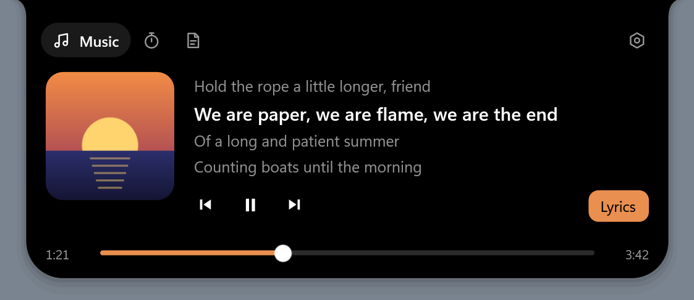

<sub>No accounts · no telemetry · no ads · about 20–30 MB of memory and under 0.5% of one CPU core when idle</sub>

<sub>Looking for the developer tools (System, Ports, Projects)? They live in the [developer fork](https://github.com/Va1Geny/masthead).</sub>

[Features](#features) · [Getting started](#getting-started) · [Hotkeys](#hotkeys) · [Privacy](#privacy) · [Architecture](#architecture)

</div>

---

## Why Skerry?

Windows spreads live activity across the tray, toasts and a dozen app windows. Skerry gathers it into one calm place at
the top of the screen: the track that is playing, a running timer, a download, a recording, the camera that is in use,
the coding agent that is waiting for your answer. When you need something, hover the pill and the island opens into
tabs and tools, then gets out of the way again.

<div align="center">
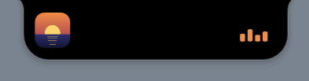&nbsp;
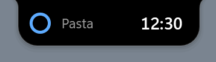&nbsp;
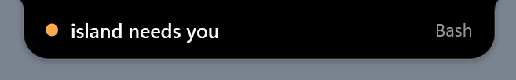&nbsp;

</div>

## Features

The pill shows the most important live activity first: a finished timer or reminder, an agent that needs you, a
recording, a microphone or camera in use, a running timer, a download or Steam progress, then music. When nothing is
happening it can show a clock, the temperature or a small mascot.

<table>
<tr>
<td width="50%" valign="top">

### 🎵 Music
Works with any app that reports to Windows media controls (Spotify, browsers, VLC…). Album art and an accent colour
taken from it, a seek bar, controls, and **synced lyrics** from LRCLIB.

</td>
<td width="50%"></td>
</tr>
<tr>
<td valign="top">

### ⏱️ Timers and reminders
Presets, free input (`90`, `1:30`, `1h30m`), a stopwatch, and reminders in plain English or Ukrainian —
`remind me in 2 hours to call mom`, `щодня о 22:00 пити воду` — with repeat rules and snooze.

</td>
<td>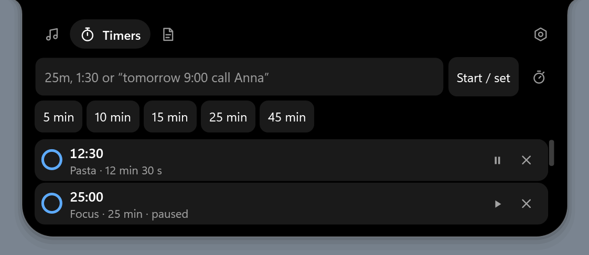</td>
</tr>
<tr>
<td valign="top">

### 📝 Notes
Formatted notes with lists, checkboxes and headings, folders, pins, search and autosave. Win+Alt+N opens a new note
from anywhere.

</td>
<td>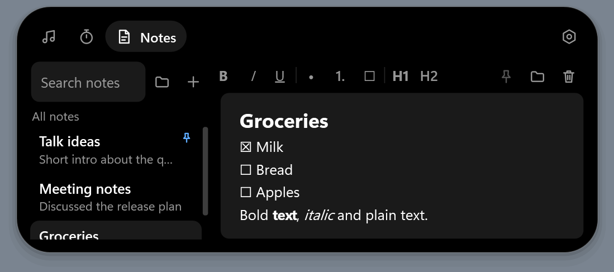</td>
</tr>
<tr>
<td valign="top">

### ⌨️ Command bar
Ctrl+Alt+Space: apps and files, a calculator with units and percentages, currency (NBU rates), timers and reminders,
system commands with confirmation, web search, and `? question` for AI.

</td>
<td>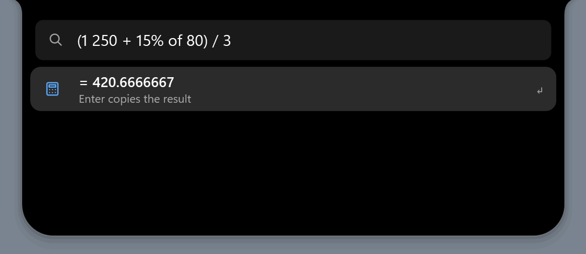</td>
</tr>
<tr>
<td valign="top">

### 🤖 Agents
Cards for Claude Code and Codex sessions: permission requests you can answer from the island, subagent progress, the
latest file edit, and a shortcut back to the session's terminal tab.

</td>
<td>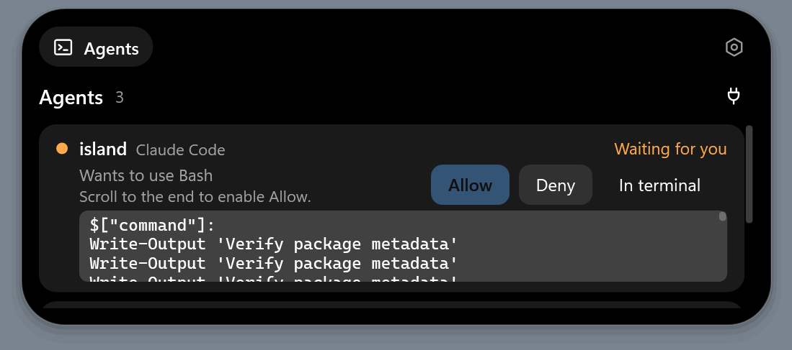</td>
</tr>
<tr>
<td valign="top">

### ✨ AI
Chat and text actions (rewrite, translate, explain…) through your own **Codex** or **Claude Code** sign-in — no API
keys to paste.

</td>
<td>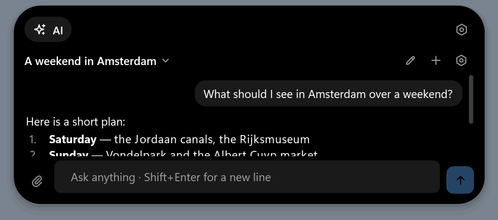</td>
</tr>
<tr>
<td valign="top">

### 🎛️ Control center
Wi-Fi, Bluetooth (and connecting headphones), dark mode, VPN profiles and clients, volume and brightness.

</td>
<td>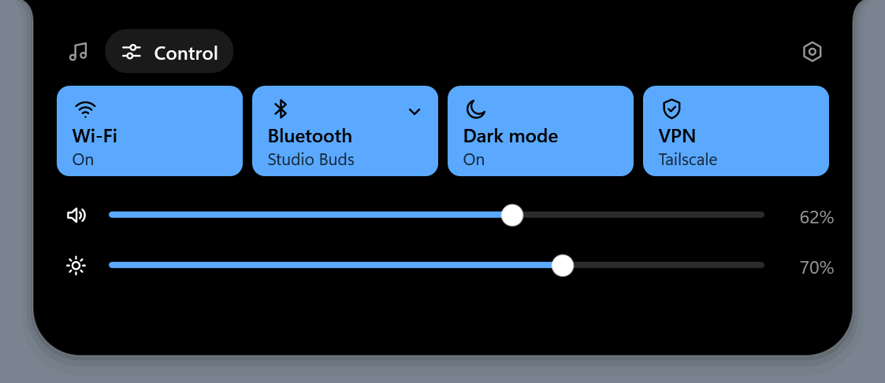</td>
</tr>
<tr>
<td valign="top">

### 🌦️ Weather
Open-Meteo forecast for 24 hours and 7 days, the temperature in the pill, and rain alerts.

</td>
<td>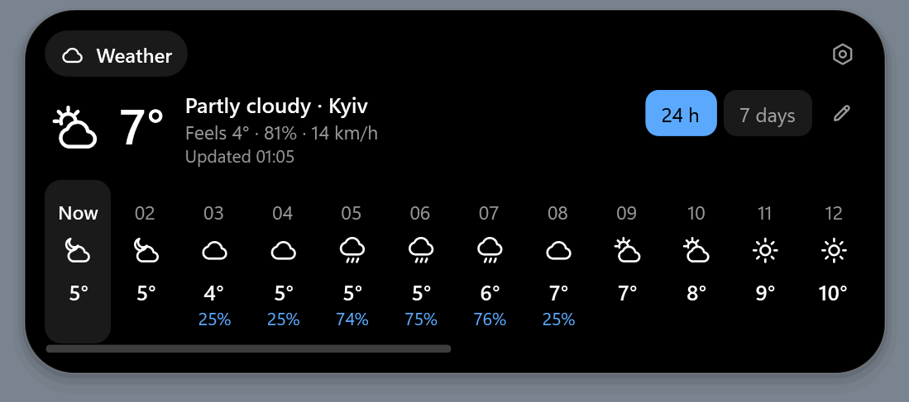</td>
</tr>
<tr>
<td valign="top">

### 📋 Clipboard and shelf
Text and image history (text encrypted with DPAPI), search and pins; click an entry to paste it where you were.
Drag files onto the island to park them on the shelf and drag them out later.

</td>
<td>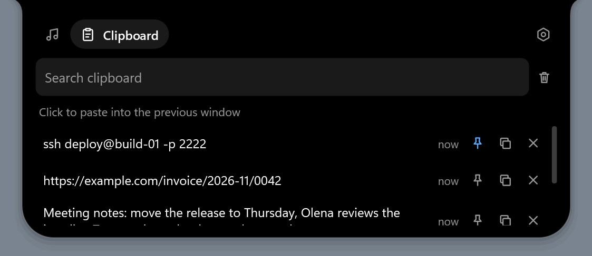</td>
</tr>
</table>

**Also included:** screenshots with markup, text capture (OCR), QR reading, a colour picker and screen recording to MP4 ·
offline **voice to text** with Whisper (hold Win+Alt+V, speak, release) · three small characters — Pebb, Sprig and Kubo —
that breathe, follow the cursor, dance to music and nap.

## Getting started

### Requirements

- Windows 10 (19041) or Windows 11, x64
- [.NET 10 SDK](https://dotnet.microsoft.com/download)
- Optional: `rustc` 1.85+ with the `x86_64-pc-windows-msvc` target and the Visual Studio C++ Build Tools, for the
  small `Skerry.Launcher.exe`. Without them the build script skips it and you start `Skerry.exe` directly.

### Build and run

```powershell
git clone https://github.com/BKyrychenko/island.git
cd island
.\scripts\build.ps1                      # build, test and publish into dist\
.\dist\Skerry\Skerry.exe                   # needs the .NET 10 Desktop Runtime
.\dist\Skerry-selfcontained\Skerry.exe     # or the self-contained build
```

Copy the whole `dist\Skerry` (or `dist\Skerry-selfcontained`) folder somewhere permanent before you enable
**Start with Windows** — the `runtimes` folder next to the exe is needed for voice to text.

For development, `dotnet build` and `dotnet test` work from the repository root.

### Settings

The gear in the panel, or right-click the tray icon → **Settings**: theme, size, language (English / Українська),
shape (notch or floating pill), monitor, auto-hide at the screen edge, click-through, apps to hide behind, modules on and off, per-module options and
hotkeys. Quit from the tray icon or with Alt+F4 while the island is focused.

## Hotkeys

All of them can be changed in **Settings → Hotkeys**.

| Action | Default |
|---|---|
| Command bar | <kbd>Ctrl</kbd>+<kbd>Alt</kbd>+<kbd>Space</kbd> |
| Show / hide the island | <kbd>Win</kbd>+<kbd>Alt</kbd>+<kbd>Space</kbd> |
| New note | <kbd>Win</kbd>+<kbd>Alt</kbd>+<kbd>N</kbd> |
| AI text actions | <kbd>Win</kbd>+<kbd>Alt</kbd>+<kbd>A</kbd> |
| Hold to talk (voice to text) | <kbd>Win</kbd>+<kbd>Alt</kbd>+<kbd>V</kbd> |
| Screenshot | <kbd>Win</kbd>+<kbd>Alt</kbd>+<kbd>S</kbd> |
| Start / stop recording | <kbd>Win</kbd>+<kbd>Alt</kbd>+<kbd>R</kbd> (Xbox Game Bar often owns this one) |
| Colour picker | <kbd>Win</kbd>+<kbd>Alt</kbd>+<kbd>C</kbd> |
| Read QR / text from the screen | <kbd>Win</kbd>+<kbd>Alt</kbd>+<kbd>Q</kbd> |

## Privacy

Everything lives in `%AppData%\Skerry\` — settings, notes, clipboard history, shelf, reminders, chats, caches, the
Whisper model and `log.txt`. Clipboard text and stored secrets (such as the OBS password) are
encrypted with Windows DPAPI for your user account. The log never contains clipboard content or messages.

The network is used only by features you turn on:

| Feature | Service |
|---|---|
| Lyrics | LRCLIB |
| Weather | Open-Meteo (optional IP location via geojs.io) |
| Currency | National Bank of Ukraine |
| AI | your installed Codex or Claude Code CLI, when you send a request |
| Voice to text | Hugging Face, once, to download the Whisper model (checksum verified) |

Agent hooks are never installed silently: **Settings → Options → Agents → Install / remove** shows exactly what will
change, backs up the config file, and removing takes out only Skerry's entries.

## Architecture

Skerry is a single WPF process (.NET 10) with a tiny Rust launcher. Features are **modules** that start lazily, can be
switched off at runtime, and are isolated from each other's failures. Each module adds a tab, pill items or hotkeys.
The window is one layered, always-on-top WPF window animated with a hand-written spring.

```
src/
  Skerry/            the app: Core (settings, pill queue, modules), Modules/*, Views/*
  Skerry.Hook/       helper the coding agents call to talk to Skerry over a named pipe
  Skerry.Launcher/   small Rust launcher that starts Skerry.exe
tests/Skerry.Tests/  xUnit tests (logic, parsers, views, live Win32 checks)
```

More in [`docs/ARCHITECTURE.md`](docs/ARCHITECTURE.md) (code map), [`docs/DECISIONS.md`](docs/DECISIONS.md) (why things
are the way they are) and [`docs/VERIFICATION.md`](docs/VERIFICATION.md) (how each feature was checked).

### Debug flags

| Flag | What it does |
|---|---|
| `--snapshot <state\|all> <out.png\|dir> [--theme Dark\|Light] [--lang en\|uk] [--scale 1.5]` | renders UI states to PNG (every screenshot in this README comes from it) |
| `--transcribe <in.wav> <out.txt> [--lang en\|uk\|nl\|auto]` | runs the voice engine on a file |
| `SKERRY_DATA_DIR=<folder>` | uses another data folder, handy for trying things without touching your data |

## Contributing

Issues and pull requests are welcome. Before you open a PR:

```powershell
dotnet build -c Release      # warnings are errors
dotnet test -c Release
```

If you change the UI, render the affected states with `--snapshot` in both themes and both languages and check them.
New user-facing text goes into both the English and Ukrainian tables in `src/Skerry/Core/Strings.Data.cs` (a test checks
they match).

## License

[MIT](LICENSE)
